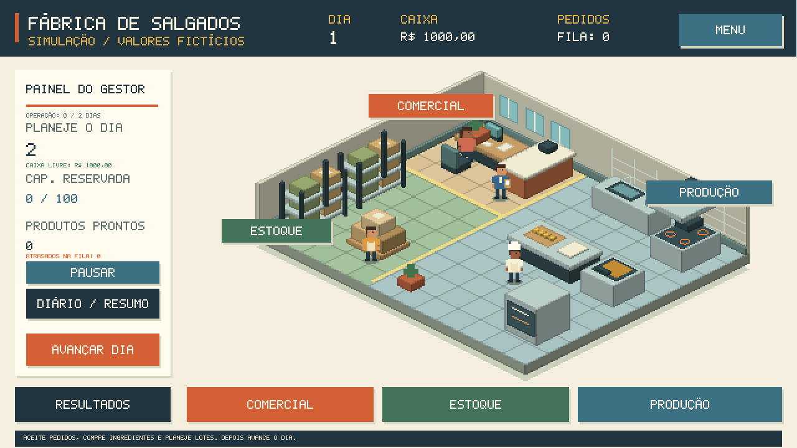
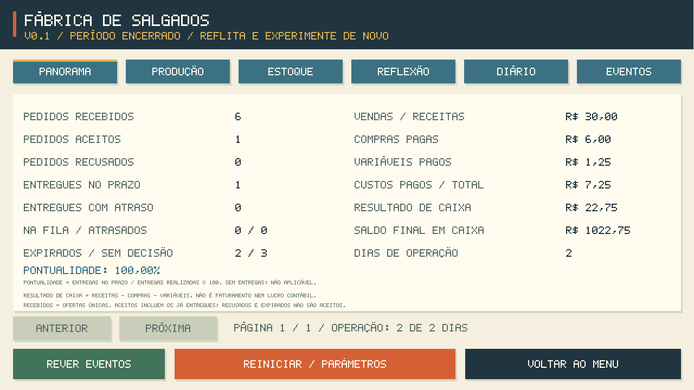

# Fábrica de Salgados — V0.1

Jogo educacional para explorar estoque, produção, pedidos, prazos e dinheiro.
**GameMaker / GML Code**, sem dependências externas obrigatórias e sem assets pagos.
Todos os números e receitas são **fictícios para aprendizagem**.



## Abrir e jogar

1. Abra **`BLANK GAMEFabricaDeSalgados.yyp`**, na raiz, pelo GameMaker.
2. Selecione Windows/VM e pressione **F5**.
3. Entre em **Novo jogo / Parâmetros**, configure a atividade e inicie.
4. Aceite pedidos, compre insumos e planeje quantidades nos três setores.
5. Use **Avançar dia**. Ao completar a duração, analise o dashboard e o diário.

Verificado com IDE **2026.0.0.16** e runtime **2026.0.0.23**. O nome original do
arquivo foi preservado. Dia 1 é preparação; a duração configura quantos dias
de operação serão processados. Pausar e rever resultados não avançam o tempo.



## Documentação

- [Manual do aluno](docs/MANUAL_DO_ALUNO.md)
- [Manual do professor e novos casos pedagógicos](docs/MANUAL_DO_PROFESSOR.md)
- [Relatório final V0.1](docs/RELATORIO_V01.md)
- [Regras e fórmulas](docs/REGRAS_SIMULACAO.md)
- [Arquitetura](docs/ARQUITETURA.md)
- [Testes reproduzíveis](docs/VALIDACAO.md)
- [Melhorias futuras e limites](docs/MELHORIAS_FUTURAS.md)
- [Substituir os visuais provisórios](docs/VISUAIS.md)

## Desenvolvimento e testes

Execute `ABRIR_NO_VSCODE.cmd` para editar. GMSync oferece a leitura dos recursos;
Stitch fica desabilitado nessa sessão por incompatibilidade com o formato instalado.
Os testes são GML. Python é usado somente para automação opcional de desenvolvimento:

```powershell
python tools/verificar_projeto.py
python tools/verificar_simulacao.py
python tools/verificar_simulacao.py --partida
```

Foram aprovadas **172 verificações**: 148 de regras/controladores e 24 em uma
partida automatizada pelas salas reais do GameMaker, com término e reinício.
Consulte os limites da validação em docs/VALIDACAO.md.

O protótipo **não salva partidas em disco**. Continuar usa apenas a sessão
aberta. Reiniciar passa pelos parâmetros antes de criar uma nova sessão.
Não existe Game Over definitivo por resultado negativo.
