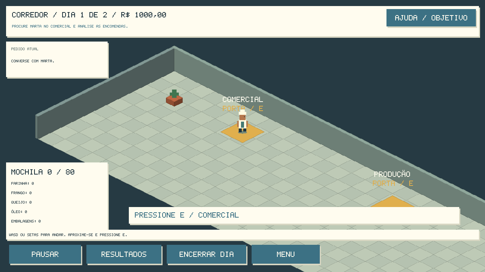
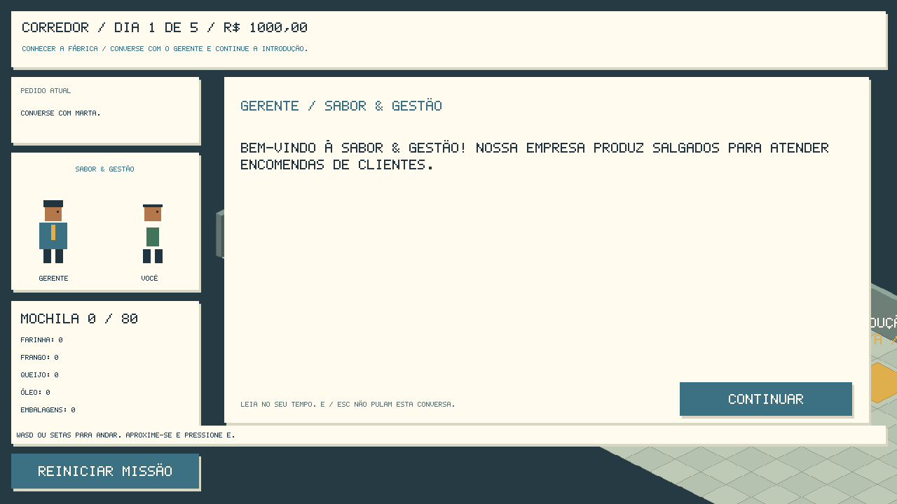
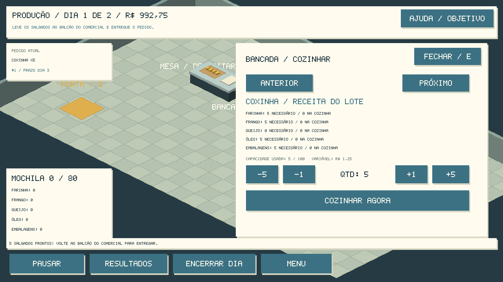

# Fábrica de Salgados — missões e aprendizagem

Jogo educacional em **GameMaker / GML Code**. Caminhe pela fábrica, transporte
ingredientes, cozinhe e entregue encomendas. Valores e receitas são **fictícios
para aprendizagem**. O projeto existente e o histórico da V0.1 foram preservados.





Agora há **História guiada**: 10 coxinhas, falta local de frango, produção e entrega,
seguida de um pedido com falta geral de queijo. Negocie, compre com prazo ou recuse.
Diálogos aguardam leitura; perguntas explicam as alternativas. **O que preciso fazer?**
orienta o próximo passo; **Reiniciar missão** recupera o capítulo com confirmação.
O modo **LIVRE** preserva a exploração anterior.

## Abrir e jogar

1. Abra `BLANK GAMEFabricaDeSalgados.yyp`, na raiz, pelo GameMaker.
2. Selecione **Windows / VM** e pressione **F5**.
3. Escolha **Novo jogo / Parâmetros**, escolha HISTÓRIA GUIADA ou LIVRE, ajuste a atividade e inicie.
4. Use **WASD ou setas** para caminhar e **E** perto de portas e equipamentos.
5. Converse com Marta no Comercial; consulte a receita na Produção; retire
   ingredientes nas prateleiras do Estoque; leve-os à mesa de depósito;
   cozinhe na bancada e volte ao balcão do Comercial para entregar.

**Encerrar dia** atualiza compras e prazos; não produz nem entrega automaticamente.
O dia 1 já é jogável. Pausa, resultados parciais, diário, reinício e dashboard
final continuam disponíveis. Não há Game Over por resultado negativo.



Ambiente: IDE **2026.0.0.16**, runtime **2026.0.0.23**, Windows/VM.
São **44 recursos registrados**: dez salas, sete objetos, 26 scripts e um sprite
próprio com oito quadros. Sem dependências externas obrigatórias ou assets pagos.

## Documentação e desenvolvimento

- [Manual do aluno](docs/MANUAL_DO_ALUNO.md) e [do professor](docs/MANUAL_DO_PROFESSOR.md)
- [Relatório desta etapa](docs/RELATORIO_HISTORIA.md) e [missões/história](docs/MISSOES_E_HISTORIA.md)
- [Relatório anterior de exploração](docs/RELATORIO_EXPLORACAO.md)
- [Arquitetura](docs/ARQUITETURA.md) e [regras](docs/REGRAS_SIMULACAO.md)
- [Testes e limites](docs/VALIDACAO.md)
- [Visuais provisórios](docs/VISUAIS.md) e [melhorias futuras](docs/MELHORIAS_FUTURAS.md)
- [Relatório histórico V0.1](docs/RELATORIO_V01.md)

Para editar, use `ABRIR_NO_VSCODE.cmd`. GMSync lê os recursos; Stitch permanece
desabilitado nessa sessão pela incompatibilidade já identificada. O jogo usa
somente GML; Python é automação opcional de desenvolvimento.

```powershell
python tools/verificar_projeto.py
python tools/verificar_simulacao.py
python tools/verificar_simulacao.py --partida
```

Os testes incluem **66 verificações novas de missões**, regressão da simulação e
partidas completas dos três caminhos educativos, além do modo livre. Consulte
[VALIDACAO.md](docs/VALIDACAO.md) para as contagens executadas e limites.

```powershell
python tools/verificar_simulacao.py --historia negociar
python tools/verificar_simulacao.py --historia comprar
python tools/verificar_simulacao.py --historia recusar
```

**Limites:** progresso persiste entre salas e pelo menu enquanto o programa está
aberto; não há salvamento em disco. Arte, colisões e animação são provisórias.
Consulte o relatório para os testes manuais ainda necessários.
