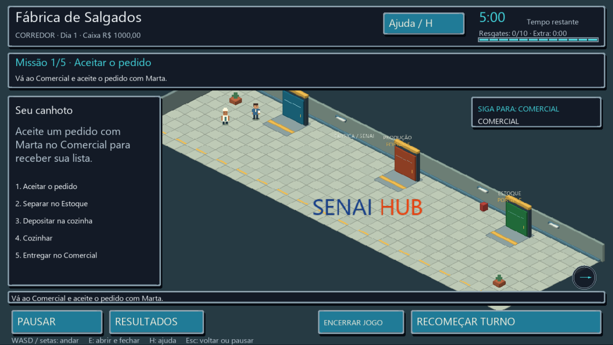
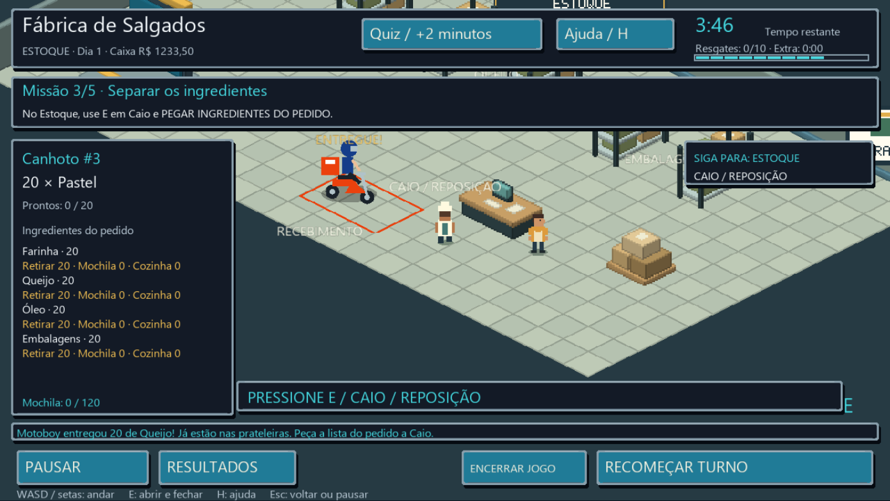

# Fábrica de Salgados · SENAI HUB

Jogo educativo em **GameMaker / GML** sobre pedidos, estoque, produção e decisões de gestão. Controle o cozinheiro, transporte os ingredientes e complete **cinco encomendas** para zerar a história. Receitas, porções e valores são fictícios para aprendizagem.

**[Jogar no navegador](https://fabrica-salgados-mundo-senai.casottimarinetti.chatgpt.site)** · **[Documentação completa](docs/README.md)** · **[Manual do jogador](docs/MANUAL_DO_ALUNO.md)**



## Como jogar

1. Escolha **JOGAR** ou **MODO COMPLETO → JOGAR HISTÓRIA / 5 PEDIDOS**.
2. Termine ou pule a introdução. Os **5 minutos** começam depois dela.
3. Aceite a encomenda com **Marta**, no Comercial. O canhoto à esquerda mostra os ingredientes.
4. No Estoque, peça a **Caio** para separar os ingredientes. Se faltar algo na empresa, compre apenas o faltante; o **motoboy chega em 12 segundos de jogo**.
5. Deposite a mochila na Produção, prepare o pedido e entregue no balcão do Comercial.
6. Confirme a entrega e aceite a próxima missão com Marta. A quinta entrega mostra **VOCÊ ZEROU O JOGO!**

| Controle | Ação |
| --- | --- |
| WASD ou setas | Andar |
| E | Interagir de perto ou fechar painel |
| Enter ou Espaço | Avançar introdução e confirmar avisos |
| Esc | Fechar painel, pausar ou voltar dos resultados |
| H / M | Ajuda / silenciar |
| 1, 2 ou 3 | Responder à pergunta de resgate |

Cada quiz correto acrescenta **2 minutos**, uma vez por pergunta. Ao zerar o relógio, uma pergunta de resgate permite ganhar mais 2 minutos: são **até dez oportunidades por rodada**. Errar o resgate encerra a rodada. Confirmações, decisões, quizzes, pausa e resultados suspendem a contagem.

## Abrir o projeto

```powershell
git clone https://github.com/Luidcasotti/fabricasalgados.git
cd fabricasalgados
```

Abra **`BLANK GAMEFabricaDeSalgados.yyp`**, na raiz, com o GameMaker. Selecione **Windows / VM** e pressione **F5**. Para exportar a versão Web, instale o módulo HTML5 do GameMaker e siga o [guia de publicação](docs/PUBLICACAO_WEB.md).

Ambiente verificado: **IDE 2026.0.0.16**, **runtime 2026.0.0.23**, Windows/VM e HTML5 no Edge. O jogo não exige Python ou Node no computador de quem joga; essas ferramentas são usadas na automação de desenvolvimento.

## O que está implementado

- Cinco missões com canhoto, objetivo e orientação entre setores.
- Estoques separados em almoxarifado, mochila e cozinha; produção e entrega presenciais.
- Motoboy, previsão de chegada, aviso de recebimento e reposição sem cobrança duplicada.
- Defeito de máquina, técnico, alternativa de equipamento e consequências educativas.
- Quizzes com tempo extra, dez resgates e confirmações por etapa.
- Resultados parciais com **VOLTAR AO JOGO**, diário, aprendizagem e indicadores calculados das operações reais.
- Modo livre configurável, sons com controle de volume, fontes legíveis e nome SENAI HUB escrito normalmente no piso.



## Documentação

| Preciso de… | Guia |
| --- | --- |
| Aprender a jogar e resolver dúvidas | [Manual do aluno](docs/MANUAL_DO_ALUNO.md) |
| Preparar uma aula e atividades | [Manual do professor](docs/MANUAL_DO_PROFESSOR.md) |
| Entender as cinco missões | [Missões e história](docs/MISSOES_E_HISTORIA.md) |
| Conferir receitas, dinheiro e tempo | [Regras da simulação](docs/REGRAS_SIMULACAO.md) |
| Entender o código | [Arquitetura](docs/ARQUITETURA.md) |
| Configurar e modificar o projeto | [Desenvolvimento](docs/DESENVOLVIMENTO.md) e [Contribuição](CONTRIBUTING.md) |
| Executar testes e conferir cobertura | [Validação](docs/VALIDACAO.md) |
| Gerar e hospedar o HTML5 | [Publicação Web](docs/PUBLICACAO_WEB.md) |
| Editar imagens e conhecer a autoria | [Visuais](docs/VISUAIS.md) e [créditos](docs/ASSETS_E_CREDITOS.md) |
| Consultar mudanças e versões anteriores | [Changelog](CHANGELOG.md) e [histórico](docs/HISTORICO.md) |

## Verificação rápida

```powershell
python tools/verificar_projeto.py
python tools/verificar_visuais.py
python tools/verificar_simulacao.py
```

A suíte no Runner oficial passou em **565 verificações**, sem falhas, em 06/11/2026. Os scripts aceitam caminhos locais do runtime e do perfil GameMaker; veja [como reproduzir](docs/VALIDACAO.md). São **105 recursos registrados**: 10 salas, 30 objetos, 31 scripts, 24 sprites, 4 fontes e 6 sons.

## Limites conhecidos

O progresso fica em memória durante a sessão. **Recarregar a página ou fechar o programa perde a partida**. O transporte dos salgados prontos é abstraído; a mochila carrega ingredientes. O jogo foi verificado nos ambientes acima; toque em celular, outras plataformas e acessibilidade completa ainda precisam de avaliação. Veja [próximos passos](docs/MELHORIAS_FUTURAS.md).
