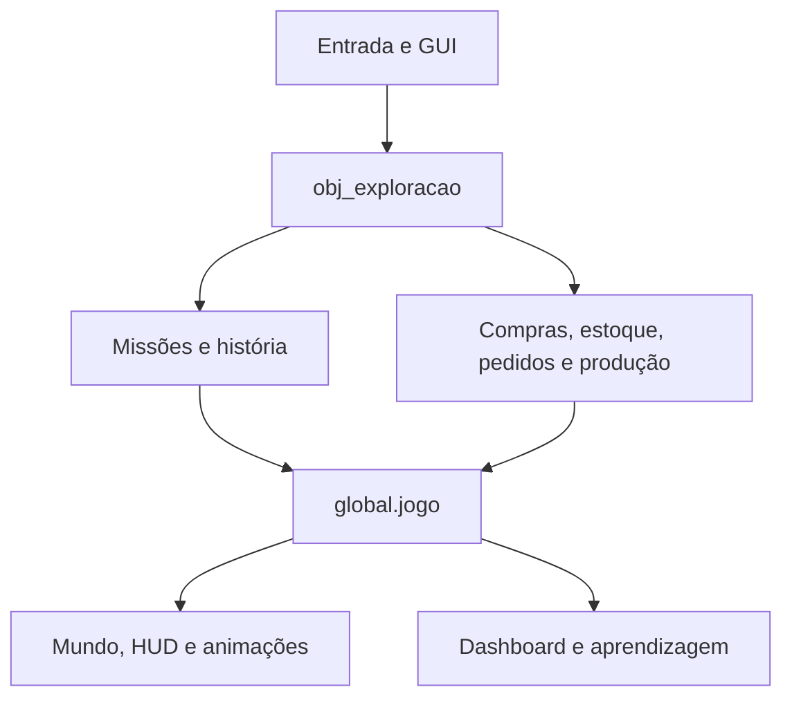

# Arquitetura

## Visão geral

A lógica está em GML e o GameMaker registra os recursos em `BLANK GAMEFabricaDeSalgados.yyp`. Python e Node são ferramentas de desenvolvimento, não dependências do jogo exportado.

Há **105 recursos**: 10 salas, 30 objetos, 31 scripts, 24 sprites, 4 fontes e 6 sons. Metadados `.yy`, manifesto `.yyp`, `.resource_order` e código `.gml` devem permanecer versionados.

## Salas e controladores

| Sala | Controlador | Uso |
| --- | --- | --- |
| `rm_menu` | `obj_menu` | Jogar, configurar ou continuar |
| `rm_parametros` | `obj_parametros` | Editar valores e escolher modo |
| `rm_corredor` | `obj_exploracao` | Ligação entre os setores e nome no piso |
| `rm_comercial` | `obj_exploracao` | Marta, ofertas e balcão de entrega |
| `rm_producao` | `obj_exploracao` | Depósito, preparo e máquinas |
| `rm_estoque` | `obj_exploracao` | Caio, prateleiras e motoboy |
| `rm_dashboard` | `obj_resultados` | Resultados parciais e consulta |
| `rm_fabrica`, `rm_resultados`, `Room1` | Recursos anteriores | Compatibilidade e histórico |

`obj_game` mantém os dados globais e evita duplicatas persistentes. Controladores locais, ator e câmeras são recriados ao trocar de sala; setor e posições são restaurados dos dados. `obj_exploracao` processa ações, desenha o mundo e a GUI e libera a câmera no CleanUp.

## Módulos principais

| Módulo | Responsabilidade |
| --- | --- |
| `scr_estado`, `scr_parametros` | Criação da sessão, padrões, validação, modos e pausa |
| `scr_produtos`, `scr_estoque` | Catálogo, receitas e saldos inteiros |
| `scr_compras` | Pagamento, trânsito, relógio do motoboy e recebimento único |
| `scr_logistica` | Mochila, cozinha, diagnóstico do faltante e produção presencial |
| `scr_pedidos`, `scr_financas` | Aceite, entrega, preço contratado e movimentos por referência |
| `scr_producao` | Planejamento, máquinas, falha e manutenção |
| `scr_missoes` | Plano de cinco pedidos, oferta atual, guia e checkpoint |
| `scr_historia` | Introdução, decisões, quizzes, confirmações e progresso de preparo |
| `scr_feira` | Cronômetro, bônus, resgates e resultado da campanha |
| `scr_mundo`, `scr_isometria` | Mapas, projeção, colisão, portas, câmera e desenho do motoboy |
| `scr_exploracao_interface`, `scr_hud_estoque` | Painéis, botões, canhoto, HUD e entradas |
| `scr_pedagogia`, `scr_dashboard`, `scr_indicadores` | Diário, aprendizagem e indicadores |
| `scr_interface`, `scr_feedback`, `scr_visuais_alunos` | Componentes, fontes, som e apresentação dos sprites |
| `scr_tempo`, `scr_fabrica_interface`, `scr_cenario`, `scr_operacoes` | Suporte compartilhado e compatibilidade com o protótipo |
| `scr_testes_*` | Auditorias, regressões e percursos opcionais |

## Estado da sessão

| Campo em `global.jogo` | Conteúdo |
| --- | --- |
| `parametros`, `catalogo` | Configuração copiada para a sessão |
| `estoque.materias_primas`, `carregados`, `cozinha` | Três localizações físicas dos ingredientes |
| `estoque.produtos`, `producao` | Produtos prontos, planos, lotes e consumo |
| `compras`, `pedidos` | Históricos, IDs únicos, trânsito e entregas |
| `financas` | Caixa, movimentos e referências para evitar duplicação |
| `exploracao` | Setor, posições, transferências, transporte e avisos do motoboy |
| `missoes` | Plano, oferta atual, entregas concluídas, falas, respostas e checkpoint |
| `feira` | Tempo decorrido, limite, bônus e dez oportunidades de resgate |
| `maquinas`, `confirmacao` | Estado dos equipamentos e aviso aguardando confirmação |
| `diario`, `historico_dias` | Ações, consequências e resumo diário |

O campo `feira` identifica a campanha cronometrada. O modo livre não o cria. A consulta de resultados não remove esse campo nem finaliza a missão.

## Ordem das operações e invariantes

1. A entrada escolhe uma ação; a API confere bloqueios, presença, quantidade e recursos.
2. A operação valida o conjunto de efeitos antes de alterar os saldos.
3. Referências únicas impedem segundo pagamento, recebimento ou entrega.
4. Eventos de sucesso atualizam o guia e o progresso da missão.
5. A confirmação informa o que já aconteceu; confirmar apenas libera a continuação.

A animação do motoboy acompanha o estado real da compra. O recebimento ocorre ao terminar o prazo, uma única vez, no almoxarifado. O preparo usa capacidade e consome os insumos da cozinha quando o lote é confirmado. O dashboard agrega os mesmos registros usados pela simulação.

## Geometria e apresentação

Coordenadas U/V representam o piso. A projeção é `X = 600 + (U - V) × 18` e `Y = 140 + (U + V) × 9`. Colisão usa os pés e os retângulos U/V de móveis e limites; subpassos evitam atravessamentos. A ordenação visual considera profundidade U+V.

A GUI usa 1280×720. O corredor tem câmera 1088×612 para mostrar a área; os setores usam 640×360. O nome SENAI HUB é texto normal sobre o chão. Fontes são atlas incorporados; o motoboy é desenho GML. A malha, os alvos E e as máscaras dos sprites são responsabilidades distintas.

## Compatibilidade

Sem `exploracao`, o núcleo mantém a simulação abstrata por dias para testes históricos. Não misture essa regra de compras com a entrega de 12 segundos da exploração. Salas e scripts anteriores permanecem registrados. Os testes são injetados apenas em cópias temporárias, nunca no carregamento normal do jogo.
