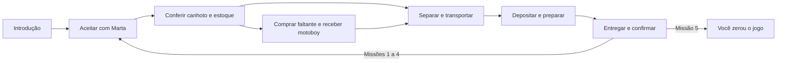

# Missões e história

## Campanha atual

**JOGAR** e **JOGAR HISTÓRIA / 5 PEDIDOS** usam a campanha cronometrada. O modo livre tem fluxo econômico aberto e não possui a mesma sequência de missões.

| Missão | Pedido | Valor padrão |
| --- | --- | ---: |
| 1 | 20 bolinhas de queijo | R$ 80,00 |
| 2 | 30 coxinhas | R$ 180,00 |
| 3 | 20 pastéis | R$ 100,00 |
| 4 | 30 coxinhas | R$ 180,00 |
| 5 | 20 bolinhas de queijo | R$ 80,00 |

São 120 salgados, R$ 620,00 de vendas e R$ 30,00 de preparo variável, antes de compras e manutenção. O estoque padrão cobre toda a receita; parâmetros diferentes podem exigir reposição. Esses valores não são fixados no dashboard: são calculados das operações reais.

## Critérios de avanço

A missão avança por **entrega efetivamente registrada**, não por visita à sala ou clique de confirmação. Aceitar gera compromisso e canhoto; retirar move material para a mochila; depositar abastece a cozinha; preparar gera salgados; entregar baixa produtos prontos e recebe o pagamento.

Uma entrega gera apenas a próxima oferta. O estado mantém IDs das missões entregues e rejeita evento repetido. Recusar preserva o registro e permite uma oferta substituta da mesma missão; não conta como entrega nem zera a história.

## Tempo e decisões

O relógio começa depois das cinco falas de introdução ou após pulá-las. Ele permanece durante todas as missões, inclusive entre entregas e durante consultas aos resultados, quando fica pausado. Quizzes concedem +120 segundos uma vez por ID; perguntas de resgate usam um banco de dez questões e no máximo dez oportunidades por rodada.

Ao zerar, o pedido e o preparo ficam preservados enquanto o jogador responde. Acerto acrescenta 120 segundos e exige confirmação. Erro, saída voluntária ou esgotamento após o décimo tempo extra encerram a rodada. A vitória exige as cinco entregas dentro do tempo disponível.

As decisões educativas sobre ingredientes e defeito apresentam opções antes das consequências. O equipamento com defeito permanece parado. Espera do técnico e capacidade reduzida influenciam o preparo real; valores e escolhas estão em [Regras](REGRAS_SIMULACAO.md).

## Checkpoint, resultados e saída

O checkpoint serializa os dados do início da história e da abertura de cada missão seguinte. RECOMEÇAR TURNO restaura juntos pedidos, caixa, estoque, compras, tempo e diálogos daquele ponto. Não é salvamento em disco.

RESULTADOS é uma consulta parcial: não conclui a história. VOLTAR AO JOGO, Esc ou Enter retoma o mesmo estado. ENCERRAR JOGO confirma a volta ao menu; CONTINUAR retoma a sessão. A vitória mostra VOCÊ ZEROU O JOGO e permanece visível até o jogador escolher jogar novamente ou voltar ao menu.

## Onde alterar

- `scripts/scr_missoes/scr_missoes.gml`: plano em `missoes_plano()`, oferta atual, guia e avanço por entrega.
- `scripts/scr_historia/scr_historia.gml`: introdução, decisões, quizzes, confirmação e preparo.
- `scripts/scr_feira/scr_feira.gml`: relógio, tempo extra, resgates e resultado cronometrado.
- `scripts/scr_testes_missoes/scr_testes_missoes.gml` e `scripts/scr_testes_feira/scr_testes_feira.gml`: regressões e percursos.

Ao mudar o plano, revise estoque, capacidade, guia, textos de final, limite de missões e testes. A meta atual é cinco; apenas aumentar a lista não atualiza todos esses pontos automaticamente.
