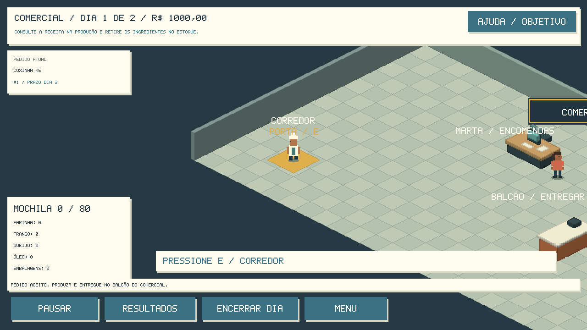
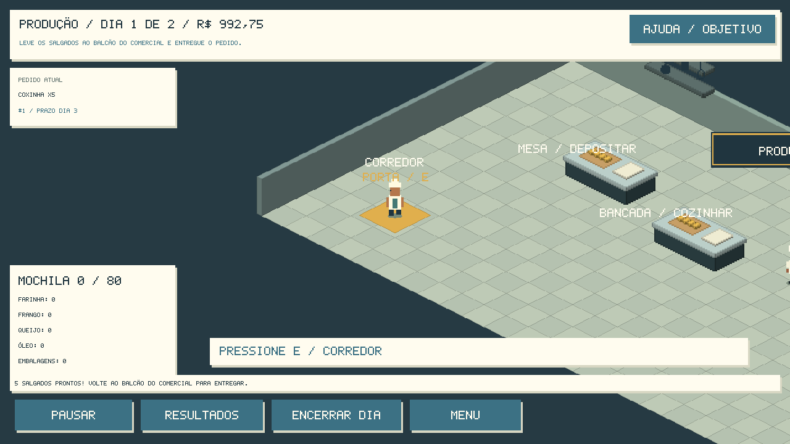
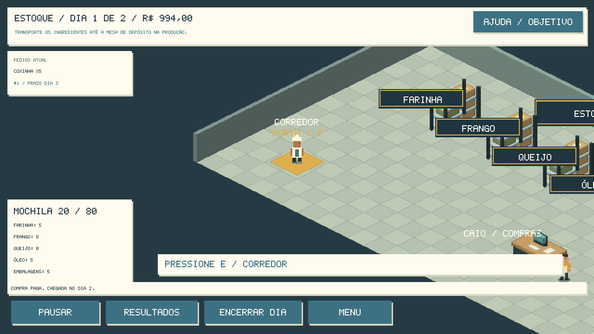
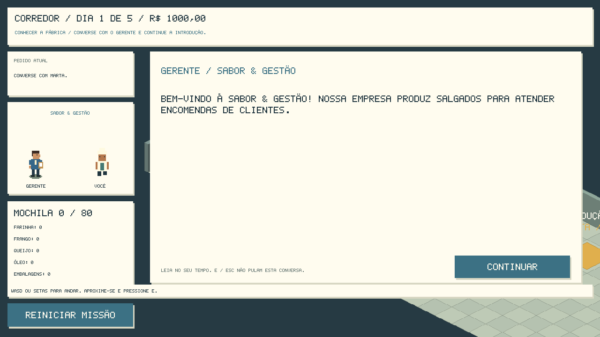

# Relatório — fábrica preparada para a aula

Verificação em **22/10/2026**, atividade prevista para **23/10/2026**.
Projeto existente: `BLANK GAMEFabricaDeSalgados.yyp`.
Raiz principal: `C:\Users\Luid Casotti\GameMakerProjects\fabrica\BLANK GAMEFabricaDeSalgados`.
Backup anterior à etapa: `C:\fabrica\.backups\antes-atividade-alunos.zip`.

## Entrega

Foram preparados **24 sprites editáveis**: 23 novos e o cozinheiro existente.
Os nomes, dimensões, origens e associações reais estão no
[Guia de sprites](atividades_alunos/GUIA_DE_SPRITES.md).

| Grupo | Sprites disponíveis |
| --- | --- |
| Comercial (4) | spr_com_balcao_aula, spr_com_computador_aula, spr_com_placa_aula, spr_com_decoracao_aula |
| Produção (5) | spr_prod_bancada_aula, spr_prod_fogao_aula, spr_prod_utensilios_aula, spr_prod_placa_aula, spr_prod_decoracao_aula |
| Estoque (10) | spr_est_caixas_aula, spr_est_prateleira_aula, spr_est_computador_aula, spr_est_placa_aula, spr_est_placa_farinha_aula, spr_est_placa_frango_aula, spr_est_placa_queijo_aula, spr_est_placa_oleo_aula, spr_est_placa_embalagens_aula, spr_est_decoracao_aula |
| Personagens (5) | spr_cozinheiro_temp, spr_atendente_aula, spr_estoquista_aula, spr_gerente_aula, spr_cozinheira_bia_aula |

Cada novo sprite está associado a um objeto `obj_aula_*` real. São **28 instâncias
visuais** nas quatro salas físicas, mantendo os três controladores originais
primeiro. Total atual: **91 recursos: dez salas, 30 objetos, 27 scripts e
24 sprites**. O cozinheiro mantém seus oito quadros; os demais começam com um.
O cenário continua propositalmente simples. Não há novos assets pagos ou externos.

Os desenhos próprios do projeto foram exportados por surfaces do GameMaker;
placas e utensílios foram desenhados em GML. Recursos registrados com escritores
do GMSync e normalizados pelo ProjectTool oficial, sem recriar o projeto.

## Preservação dos sistemas

Movimentação, colisões, portas, alvos E, estoque, mochila, produção, pedidos,
missões, diálogos, finanças e dashboard continuam com a lógica anterior.
A integração apenas consulta os sprites associados e os desenha na projeção
existente. Ajustes nos scripts anteriores ficaram em `mundo_desenhar` e
`historia_retrato`, sem alterar o mapa ou a progressão. Placas de ingredientes
passaram para depois dos móveis na ordem de desenho para evitar texto encoberto.

`tools/verificar_visuais.py` confere dimensões/origens, 31 quadros PNG visíveis
com transparência, associações, instâncias e os hashes de **26 módulos de lógica
preservada**. Móveis mantêm bases 128×128/(64,80); os demais contratos constam
no guia. As máscaras dos sprites novos não comandam a colisão: ela continua
no mapa U/V. Os alunos só devem editar as imagens dentro da silhueta original.

## Material dos grupos

Os seis documentos estão em `docs/atividades_alunos/`:

- [ATIVIDADE_COMERCIAL.md](atividades_alunos/ATIVIDADE_COMERCIAL.md)
- [ATIVIDADE_PRODUCAO.md](atividades_alunos/ATIVIDADE_PRODUCAO.md)
- [ATIVIDADE_ESTOQUE.md](atividades_alunos/ATIVIDADE_ESTOQUE.md)
- [ATIVIDADE_PERSONAGENS.md](atividades_alunos/ATIVIDADE_PERSONAGENS.md)
- [GUIA_DE_SPRITES.md](atividades_alunos/GUIA_DE_SPRITES.md)
- [ROTEIRO_DA_AULA.md](atividades_alunos/ROTEIRO_DA_AULA.md)

O roteiro traz objetivo pedagógico, divisão dos grupos, sequência sugerida de
50 minutos, testes, integração das entregas e critérios de avaliação. Também
lista arquivos protegidos: scripts, objetos, salas, opções, ferramentas e .yyp.

## Testes realmente executados

Ambiente: **GameMaker IDE 2026.0.0.16, runtime 2026.0.0.23, Windows/VM**.

| Verificação | Resultado |
| --- | --- |
| ProjectTool SAVE e OPEN | Código 0; SUCCESSFUL LOAD AND LINK nos 91 recursos. |
| Compilação normal, sem injeção de testes | Igor código 0; 24 sprites, 30 objetos, dez salas. |
| Validador do projeto | Registro, referências, eventos, quadros e ordem das salas OK. |
| Validador visual | 24 sprites, 31 quadros, 23 associações novas, 28 instâncias e 26 módulos preservados OK. |
| Regras da simulação/interface/V0.1/exploração/missões | 72 + 22 + 54 + 83 + 66 = **297 checks**, zero falhas. |
| Partida real em modo livre | **123 checks**, encerrada com dashboard e reinício. |
| História guiada, ramo negociar | **206 checks**, duas entregas, sete abas do dashboard e reinício. |

São **626 verificações** nos três percursos de referência, com checks comuns
repetidos; não são 626 cenários independentes. A suíte de regras precedeu o
último ajuste de ordem das placas, exclusivamente visual; os dois percursos de
partida e a validação visual foram executados após ele. Os hashes confirmam
que nenhuma regra mudou.

O Runner executou caminhada e colisão, atravessou **Corredor, Comercial, Estoque
e Produção**, abriu/fechou painéis por E e ações da GUI, transportou ingredientes,
cozinhou e entregou a encomenda inicial. A história também processou a reposição
com prazo e a segunda entrega. Estoques e estados foram auditados durante as
partidas. O driver calcula trajetos com colisão e acelera a caminhada; não
teletransporta para as ações. São execuções automatizadas no motor GameMaker,
sem alegação de teste humano completo de teclado/mouse.

Uma tentativa inicial do modo livre foi interrompida durante o fechamento da
IDE; o teste foi repetido sem interferência e aprovado. As capturas abaixo vêm
da versão final com os sprites novos; a câmera acompanha o jogador, portanto
o setor inteiro não cabe em todas as imagens.

## Abrir e executar na aula

1. Extraia uma cópia completa do projeto para cada grupo. Abra o arquivo
   **BLANK GAMEFabricaDeSalgados.yyp** na raiz pelo GameMaker.
2. Selecione **Windows / VM** e pressione **F5**.
3. Escolha Novo jogo / Parâmetros → HISTÓRIA GUIADA → iniciar, com os padrões.
4. Leia as falas, ande com WASD/setas e use E. Receba as 10 coxinhas com Marta,
   consulte a bancada, busque frango no Estoque, deposite, cozinhe e entregue.
5. Para editar: pare o jogo, pesquise o sprite exato no Asset Browser, abra
   Edit Image, preserve tela/origem e salve. Pressione F5 novamente e teste.

O VS Code continua disponível por `ABRIR_NO_VSCODE.cmd`; para esta aula o editor
de imagens da IDE é suficiente. A instalação de extensões não é necessária.

## Limites e pendências

Nenhum erro bloqueou iniciar e terminar os percursos executados. A aparência é
provisória; todos os elementos não precisam de refinamento antes da aula.
Piso, paredes, portas, pia, forno, cadeiras e plantas do corredor ainda são
primitivas GML e não entram na edição dos estudantes. O fogão e os utensílios
são cenário; a produção funcional continua na bancada.

A avaliação humana da legibilidade/usabilidade e a execução nos computadores
da turma ficam para a preparação presencial. Outros alvos, YYC e resoluções
não foram testados nesta etapa. Os ramos comprar/recusar mantêm a validação da
etapa anterior; não foram reexecutados para esta mudança de apresentação.
Não há salvamento de sessão em disco: Continuar/checkpoint duram enquanto o
programa está aberto. Faça uma cópia por grupo e teste novamente após integrar
os desenhos, conforme o roteiro.
